<!--
  github.com/Ash5457 profile
  assets/header.svg     built by scripts/build_header.py
  metrics.terminal.svg  rendered by lowlighter/metrics
  Both refresh daily via .github/workflows/profile.yml
-->

  

  
  
  
  
  
  
   
  
  
  
  
  

### `$ cat about.txt`

I learn by building on my own hardware, then writing up what broke and how I fixed it. Each writeup covers the goal, the setup, and the troubleshooting log.

### `$ ls ~/projects`

**[secure-remote-access](https://github.com/Ash5457/secure-remote-access)** · `RDP` `Tailscale` `WireGuard` `Windows Firewall` `Fedora`\
Encrypted remote desktop from a Fedora laptop to a Windows 11 Pro machine over public Wi-Fi, with RDP never exposed to the internet. Walks through a layer-by-layer diagnosis of a Kerberos/NTLM logon failure and a routing conflict between two WireGuard-based tools.

**[HackDetect](https://github.com/Ash5457/HackDetect)** · `Python` `OOP`\
Terminal social deduction game built for a university game studies course. Analysts investigate a simulated breach while one player may secretly be the attacker planting false evidence.

**Active Directory homelab** · `Windows Server` `AD DS` `Group Policy` · *writeup in progress*\
Server 2016 domain on VMware with Windows 10 clients. Next up: a side-by-side migration to Server 2025 (new DC, FSMO transfer, dcdiag, demotion), then Entra Connect and Intune.

### `$ ssh Ash5457@metrics`

  

### `$ ./contact.sh`

[LinkedIn](https://www.linkedin.com/in/itprofessionalakash/) · [akashbahl1926@gmail.com](mailto:akashbahl1926@gmail.com)
